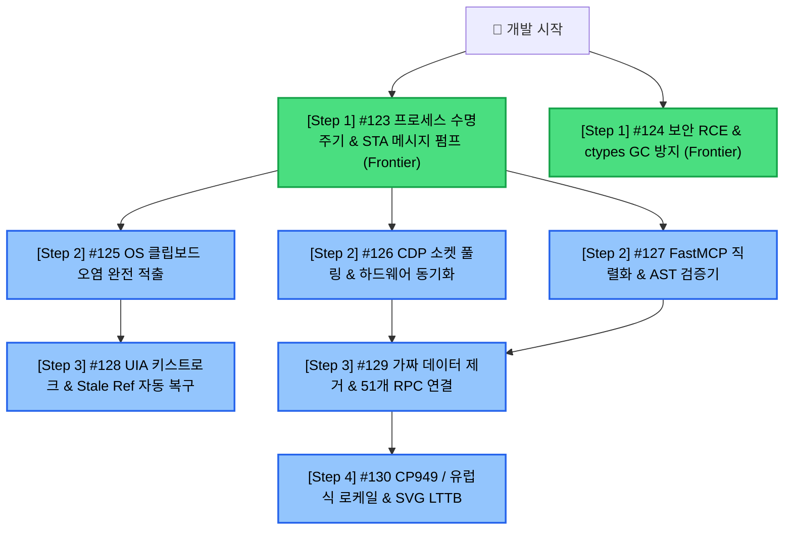

# 🛠️ Capstone-MCP 결함 수리 및 개발자 온보딩 가이드 (Remediation Guide)

> **"426개라는 숫자에 압도되지 마세요! 실제로는 15개의 핵심 급소(Root Cause)에서 파생된 증상들입니다."**  
> 본 문서는 `capstone-mcp` 저장소를 처음 클론받아 결함 수정에 참여하는 동료 엔지니어를 위해 작성된 **실전 작업 지침서**입니다.

---

## 1. 🗺️ 어디서부터 시작해야 하는가? (추천 작업 순서 & DAG)

426건의 결함은 **8개의 독립된 Tracer-Bullet 에픽 티켓([#123](https://github.com/ji5zi5/capstone-mcp/issues/123) ~ [#130](https://github.com/ji5zi5/capstone-mcp/issues/130))**으로 나누어져 있습니다.  
의존성 그래프에 따라 **선행 의존성이 없는 프론티어(Frontier) 티켓부터** 시작하시는 것을 강력히 권장합니다.



* **지금 바로 시작할 수 있는 티켓**: **[#123](https://github.com/ji5zi5/capstone-mcp/issues/123)** 또는 **[#124](https://github.com/ji5zi5/capstone-mcp/issues/124)**
* 가장 많은 하위 티켓이 의존하는 핵심 기반이므로, **#123 티켓 하나만 해결해도 시스템 전체 안정성의 40% 이상이 즉시 개선**됩니다.

---

## 2. 💻 개발 환경 셋업 & 치트시트

### 1) 환경 요구사항
* **OS**: Windows 10 (1703+) 또는 Windows 11 (x64)
* **Python**: 3.12+
* **패키지 매니저**: [uv](https://docs.astral.sh/uv/) (Astral)

### 2) 클론 및 가상환경 구성
```powershell
git clone https://github.com/ji5zi5/capstone-mcp.git
cd capstone-mcp
uv sync --python 3.12
```

### 3) ⚠️ 필수 주의: 테스트 및 린터 구동 시 `--no-sync` 플래그
> [!IMPORTANT]
> Windows 환경에서는 백그라운드 MCP 서버 프로세스나 IDE가 `capstone-mcp.exe` 바이너리를 파일 핸들로 잡고 있을 수 있습니다.  
> 따라서 `uv run` 명령어 사용 시 **반드시 `--no-sync` 플래그를 붙여야** `os error 32` (다른 프로세스가 파일을 사용 중) 잠금 에러를 방지할 수 있습니다.

```powershell
# 단위 테스트 전체 구동 (Capstone 앱이 안 켜져 있어도 100% 통과해야 함)
uv run --no-sync pytest

# 특정 파일 또는 키워드 테스트 구동
uv run --no-sync pytest tests/test_calculator.py -k "test_formula"

# 린터 및 포맷 검사
uv run --no-sync ruff check src tests

# 정적 타입 검사 (Basedpyright)
uv run --no-sync basedpyright src
```

---

## 3. 💡 8대 에픽별 핵심 급소 & 추천 구현 패턴 (Cheat Sheet)

### 🎯 에픽 1: [#123](https://github.com/ji5zi5/capstone-mcp/issues/123) 프로세스 수명주기 & STA 메시지 펌프
* **주요 타깃 파일**: `src/capstone_mcp/native_loop.py`, `src/capstone_mcp/automation_worker.py`, `src/capstone_mcp/desktop.py`
* **문제점**: 백그라운드 스레드에서 Windows 표준 메시지 루프가 돌지 않아 COM RPC 응답이 큐에 갇혀 60초 타임아웃 후 워커가 강제 사살됨.
* **수리 팁**:
  ```python
  # native_loop.py 내 이벤트 대기 루프에 메시지 펌프 장착
  import win32gui
  while running:
      win32gui.PumpWaitingMessages()  # COM RPC 윈도우 메시지 처리
      # time.sleep 대신 PeekMessage 기반 대기 적용
  ```

---

### 🎯 에픽 2: [#124](https://github.com/ji5zi5/capstone-mcp/issues/124) 보안 RCE & ctypes GC 방지
* **주요 타깃 파일**: `src/capstone_mcp/ui_events.py`, `src/capstone_mcp/desktop.py`, `src/capstone_mcp/capfiles/archive.py`
* **문제점**: `WINFUNCTYPE` 콜백이 지역 변수에 담겨 가비지 컬렉터(GC)에 의해 메모리 해제된 뒤, OS가 이벤트를 쏠 때 댕글링 포인터 접근 위반(`0xC0000005`) 크래시 발생.
* **수리 팁**:
  ```python
  # ui_events.py 모듈 레벨에 강력 참조 보존
  _ACTIVE_WINEVENT_HOOKS: set[ctypes.c_void_p] = set()
  _CALLBACK_REFS: set[Any] = set()

  # 훅 해제 시점에만 set.discard()로 안전하게 제거
  ```
  * `desktop.py`의 `--remote-allow-origins=*` 플래그 제거 및 로컬 전용 오리진 검증.
  * `archive.py`에서 `os.path.commonpath`를 사용해 Zip Slip(Path Traversal) 차단.

---

### 🎯 에픽 3: [#125](https://github.com/ji5zi5/capstone-mcp/issues/125) OS 클립보드 오염 완전 적출
* **주요 타깃 파일**: `src/capstone_mcp/graphs/inspection.py`, `src/capstone_mcp/tools/ui.py`
* **문제점**: 그래프나 표 데이터를 긁어올 때 UIA "Copy Display" 메뉴를 누르고 사용자 클립보드를 가로채는 방식 때문에 사용자의 작업 데이터가 영구 파괴됨.
* **수리 팁**:
  * 클립보드 API(`win32clipboard`, `pyperclip`, `GetClipboardSequenceNumber`) 전면 제거.
  * QWebChannel RPC 또는 Capstone 내부 COM/C++ 객체 포인터에서 직접 메모리 버퍼를 읽도록 변경.

---

### 🎯 에픽 4: [#126](https://github.com/ji5zi5/capstone-mcp/issues/126) CDP 소켓 풀링 & 하드웨어 클록 동기화
* **주요 타깃 파일**: `src/capstone_mcp/bridge.py`, `src/capstone_mcp/session/cdp_client.py`, `src/capstone_mcp/session/telemetry.py`
* **문제점**: 계측값 조회 시 매번 새로운 TCP/WebSocket을 연결하여 Windows의 `TIME_WAIT` 소켓이 120초 만에 4,000개 이상 쌓이며 포트 고갈(WSAEADDRINUSE 10048) 발생.
* **수리 팁**:
  * 단일 지속(Persistent) WebSocket 세션을 유지하고, 연결 끊김 시 지수 백오프(Exponential Backoff)로 자동 재연결.
  * PASCO 850 FPGA 고정밀 타임스탬프를 보존하여 호스트 OS 시계 지터 제거.

---

### 🎯 에픽 5: [#127](https://github.com/ji5zi5/capstone-mcp/issues/127) FastMCP 직렬화 & AST 수식 검증기
* **주요 타깃 파일**: `src/capstone_mcp/calculator.py`, `src/capstone_mcp/tools/*.py`
* **문제점**: 괄호가 맞지 않는 수식을 무조건 타이핑하고 Capstone에 에러 모달이 떠도 `verified=True`를 날조함.
* **수리 팁**:
  * `ast.parse` 또는 토크나이저를 사용해 Capstone 창에 타이핑하기 전 괄호 균형과 연산자 문법을 사전 검증.
  * FastMCP 모델의 `model_dump_json(exclude_none=True)`로 null 직렬화 방어.

---

### 🎯 에픽 6: [#128](https://github.com/ji5zi5/capstone-mcp/issues/128) UIA 키스트로크 인젝션 방어 & Stale Ref 복구
* **주요 타깃 파일**: `src/capstone_mcp/runs/manager.py`, `src/capstone_mcp/desktop.py`
* **문제점**: 런 이름에 `{1}` 입력 시 pywinauto가 가상키 시퀀스로 해석해 크래시 발생, 컨트롤 재생성 시 이전 핸들을 계속 참조하여 폭사.
* **수리 팁**:
  * 텍스트 입력 시 `send_keys` 대신 `ValuePattern.SetValue()` 사용.
  * `ElementNotAvailableException` 발생 시 window cache를 비우고 1회 자동 재탐색.

---

### 🎯 에픽 7: [#129](https://github.com/ji5zi5/capstone-mcp/issues/129) 가짜 데이터 제거 & 51개 RPC 연결
* **주요 타깃 파일**: `src/capstone_mcp/recipes/`, `src/capstone_mcp/tools/reports.py`
* **문제점**: 실기 통신 실패 시 `_canonical_fallback_series`로 가짜 난수 데이터를 생성해 마치 실험이 성공한 것처럼 사기 침.
* **수리 팁**:
  * 가짜 난수 Fallback 모듈 전면 삭제 -> 실패 시 솔직한 `DeviceConnectionError` 반환.
  * QWebChannel의 51개 네이티브 RPC 엔드포인트 실기 연결.

---

### 🎯 에픽 8: [#130](https://github.com/ji5zi5/capstone-mcp/issues/130) 다국어 CP949 & 유럽식 CSV 로케일
* **주요 타깃 파일**: `src/capstone_mcp/csv_data.py`, `src/capstone_mcp/file_workflows.py`
* **문제점**: 한국어 Windows 기본 CP949 CSV 파일을 `utf-8-sig`로만 읽으려다 `UnicodeDecodeError` 500 크래시 발생.
* **수리 팁**:
  ```python
  # csv_data.py 내 인코딩 폴백 체인
  ENCODINGS = ["utf-8-sig", "cp949", "euc-kr", "latin1"]
  for enc in ENCODINGS:
      try:
          return content.decode(enc)
      except UnicodeDecodeError:
          continue
  ```

---

## 4. 🌿 브랜치 생성 및 PR 워크플로우

1. **브랜치 생성**:
   ```powershell
   git checkout main
   git pull origin main
   git checkout -b fix/issue-123-process-lifecycle
   ```
2. **TDD 사이클 준수**:
   * 버그를 재현하는 테스트 케이스를 `tests/`에 먼저 작성 (`pytest` 실패 확인)
   * `src/capstone_mcp/`의 프로덕션 코드 수정 (`pytest` 통과 확인)
   * 린터 및 타입체커 통과 (`ruff`, `basedpyright`)
3. **커밋 및 푸시**:
   ```powershell
   git add .
   git commit -m "fix(native): implement STA message pump loop to prevent RPC lockup (#123)"
   git push origin fix/issue-123-process-lifecycle
   ```
4. **GitHub PR 생성**:
   * PR 본문에 `Closes #123`을 명시하면 머지 시 티켓이 자동으로 완료 처리됩니다.
