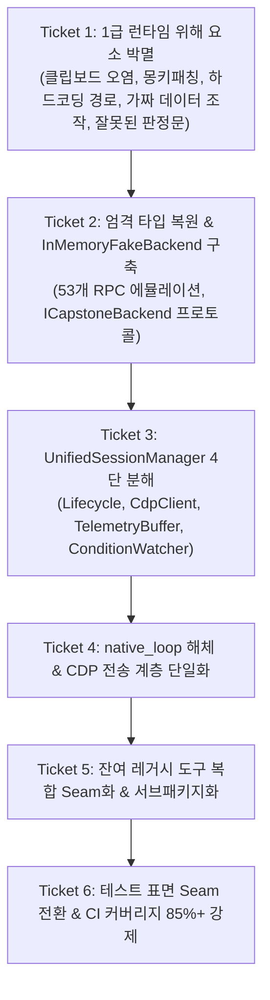

# Phase 11: Core Defect Eradication & Complete Deep Modularization

- **상태 (Status)**: 승인됨 (Approved)
- **일자 (Date)**: 2026-11-15
- **근거 문서 (Governing ADRs)**:
  - [ADR 0001: Tool Surface and IPC Diagnostics](docs/adr/0001-tool-surface-and-ipc-error-remediation.md)
  - [ADR 0002: Bridge Unification and Runtime Verification](docs/adr/0002-bridge-unification-and-runtime-verification.md)
  - [ADR 0003: CDP Primary Telemetry and UIA Auxiliary Fallback](docs/adr/0003-cdp-primary-telemetry-and-uia-fallback.md)
  - [ADR 0004: 15대 코어 부채 전수 박멸, 무부작용 인터페이스 확립 및 InMemoryFakeBackend 도입](docs/adr/0004-fake-backend-and-defect-eradication.md)

---

## 1. Problem Statement (문제 정의)

전수 코드베이스 감사(`capstone_mcp_exhaustive_defect_whitepaper.md`)를 통해 코드베이스 밑바닥에 도사리고 있던 15대 핵심 구조적 부채가 적발됨:

1. **OS 전역 클립보드 오염 (`graphs/inspection.py`)**: 그래프 상태를 읽기 위해 Windows 전역 클립보드를 오버라이트하여 사용자 데이터/비밀번호를 파괴함.
2. **프레임워크 내부 몽키패칭 (`server.py`)**: `MCP._mcp_server.request_handlers` 비공개 딕셔너리를 런타임에 직접 조작함.
3. **실행 파일 경로 하드코딩 (`desktop.py`)**: `C:/Program Files/.../Capstone.exe` 절대 경로 고정으로 이식성 결여.
4. **실험 실패 시 가짜 합성 데이터 주입 조작 (`reports/generator.py`)**: 파일 로드 실패 시 가짜 합성 데이터를 몰래 삽입하여 성공으로 위장함.
5. **타입체커 경보기 고의 은폐 (`pyproject.toml`)**: `reportAttributeAccessIssue = "none"`, `reportCallIssue = "none"` 설정으로 결함을 은폐함.
6. **존재하지 않는 메서드 호출 (`generator.py`, `sensors.py`, `wireless.py`)**: `Capstone` 클래스에 없는 `app.click()`, `app.type_text()` 호출.
7. **연결 상태 정반대 판정 (`wireless.py`)**: `"connected" in name.lower()` 검사로 disconnected 센서를 연결된 것으로 오판.
8. **설정값 소멸 버그 (`harness.py`)**: `type_text` 부재 시 빈칸으로 Enter를 쳐서 스코프/FFT 설정값을 날려버림.
9. **포트 불일치 (`repetition.py`)**: 기본값이 9223으로 하드코딩되어 실제 9222 포트의 Capstone과 통신 거부.
10. **`native_loop.py` (1,019줄) 모놀리스**: stdin/stdout 파이프 기반의 복잡한 STA 루프.
11. **이중 IPC 분열**: 고속 CDP(포트 9222)와 저속 파이프 워커가 따로 놀며 명령 경로 파편화.
12. **`UnifiedSessionManager` God Object**: 7중 책임이 한 클래스에 엉킴.
13. **레거시 도구 분산**: `files.py`와 `physics.py`에 개별 함수로 파편화된 도구 잔존.
14. **루트 25개 평면 파일 난립**: 도메인 경계 없이 단일 디렉터리에 파일 난립.
15. **`InMemoryFakeBackend` 부재**: CI 환경에서 실물 없이 테스트하기 위해 `skipif`로 도피함.

---

## 2. Architecture & Design Principles (설계 원칙)

1. **무부작용 인터페이스 (Side-Effect Free)**:
   - OS 전역 클립보드 오염, 프레임워크 몽키패칭, 가짜 합성 데이터 주입을 완전히 제거함.
2. **프로토콜 주도 백엔드 (Protocol-Driven Backend)**:
   - `ICapstoneBackend` 프로토콜을 정의하고, 이를 구현하는 `InMemoryFakeBackend`를 구축하여 CI 환경에서 실물 Capstone 없이도 53개 RPC 동작과 도메인 로직을 100% 검증함.
3. **The Interface is the Test Surface (테스트 표면 일치)**:
   - 내부 GUI 좌표나 private helper가 아닌, 공개된 도메인 Seam(`manage_*`)을 직접 테스트 표면으로 일원화함.
4. **무결점 정적 타입 검증 (Zero Type Mirage)**:
   - `pyproject.toml`에서 타입 검사 은폐 옵션을 전면 제거하고 Basedpyright `standard` 모드에서 0 errors를 유지함.

---

## 3. Work Breakdown & Tracer-Bullet Tickets (티켓 분할)

### Ticket 1: 1급 런타임 위해 요소 박멸
- **대상 파일**: `src/capstone_mcp/graphs/inspection.py`, `src/capstone_mcp/server.py`, `src/capstone_mcp/desktop.py`, `src/capstone_mcp/reports/generator.py`, `src/capstone_mcp/instruments/wireless.py`, `src/capstone_mcp/displays/harness.py`, `src/capstone_mcp/repetition.py`
- **주요 작업**:
  - `graphs/inspection.py`: Windows OS 전역 클립보드 탈취 로직 삭제, CDP/인메모리 버퍼 쿼리로 전환.
  - `server.py`: FastMCP 비공개 멤버 몽키패칭 제거, 정식 핸들러 패턴 적용.
  - `desktop.py`: 실행 파일 절대 경로 하드코딩 제거, 환경변수(`CAPSTONE_EXECUTABLE`) 및 레지스트리 동적 탐색기 도입.
  - `reports/generator.py`: 실패 시 가짜 데이터 조작 주입(`_canonical_fallback_series`) 완전 삭제, 파일 로드 실패 시 명확한 에러 발생.
  - `instruments/wireless.py`: `"connected" in name.lower()` 오판정 수정 (`disconnected` 상태 정확 판정).
  - `displays/harness.py`: `type_text` 누락 시 빈값 Enter 입력 버그 수정.
  - `repetition.py`: 9223 하드코딩 포트를 9222 표준 포트로 교정.
- **인수 기준**:
  - 전역 클립보드 오염 없음.
  - FastMCP 몽키패치 제거.
  - 가짜 데이터 주입 코드 0줄.
  - 모든 단위 테스트 통과 및 원격 CI 성공.

### Ticket 2: 엄격 타입 복원 & `InMemoryFakeBackend` 구축
- `pyproject.toml`에서 `reportAttributeAccessIssue`, `reportCallIssue`를 `error`로 복원.
- `ICapstoneBackend` 프로토콜 정의 및 53개 RPC 에뮬레이션 `InMemoryFakeBackend` 구축.

### Ticket 3: `UnifiedSessionManager` God Object 4단 분해
- `Lifecycle`, `CdpClient`, `TelemetryBuffer`, `ConditionWatcher`로 분해.

### Ticket 4: `native_loop.py` 모놀리스 해체 및 CDP 전면 단일화
- 파이프 통신 퇴역 및 CDP 단일화.

### Ticket 5: 잔여 레거시 도구 복합 Seam화 & 서브패키지화
- `tools/files.py`, `tools/physics.py` 복합 Seam으로 통합, `server.py` 150줄 슬림화.

### Ticket 6: 테스트 표면 Seam 전환 & CI 커버리지 85%+ 강제
- 테스트 스위트 재정렬 및 커버리지 측정.
